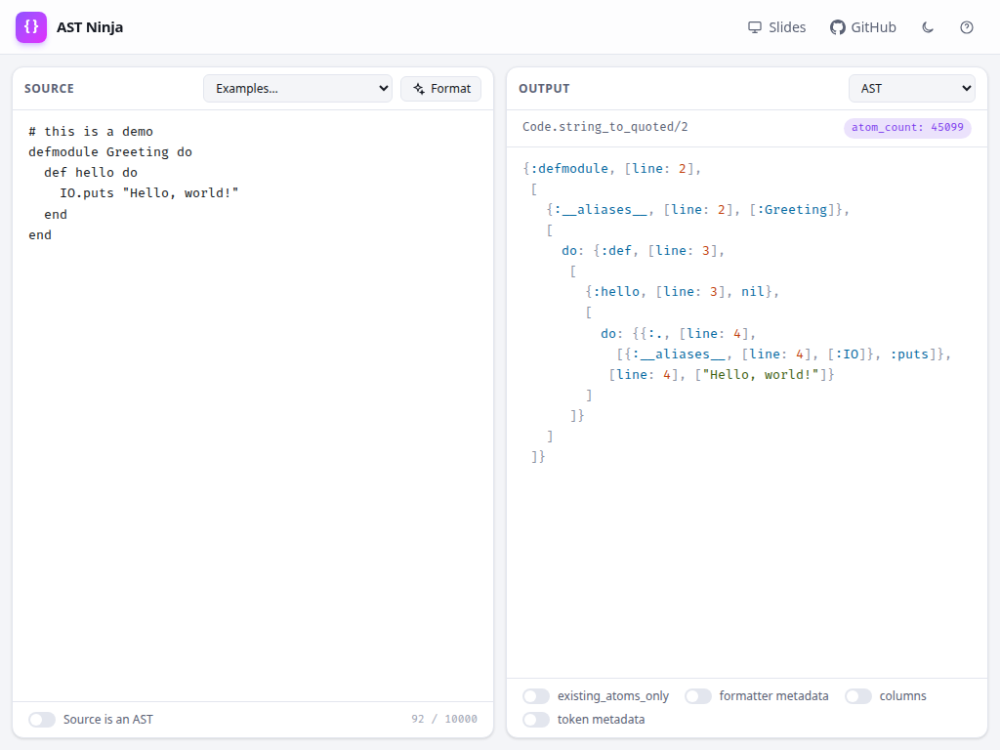

# Interactive Elixir AST explorer

Type some Elixir(ish) code, have it parsed by the Elixir parser, and
inspect the output in real time. Like
[Code.string_to_quoted/2](https://hexdocs.pm/elixir/Code.html#string_to_quoted/2),
but in a browser.

Live: https://ast.miraclethings.nl/

Built with Phoenix LiveView. Besides the AST, it shows the tokenizer
output, AST → string round-tripping, the AST as JSON, the formatter's
algebra document, a filter-expression-to-SQL demo and a small leex/yecc
integer parser.

## Running locally

Needs Elixir 1.19 / OTP 28 (see `.tool-versions`); no Node.js.

    mix setup
    mix phx.server

Then open http://localhost:4000.

## Docker

Every push to `master` is tested and published to
`ghcr.io/arjan/ast_ninja:latest`.

    docker run -p 4000:4000 \
      -e SECRET_KEY_BASE=$(mix phx.gen.secret) \
      -e PHX_HOST=localhost \
      ghcr.io/arjan/ast_ninja:latest

| Variable          | Required | Default     |
| ----------------- | -------- | ----------- |
| `SECRET_KEY_BASE` | yes      |             |
| `PHX_HOST`        | no       | `ast.ninja` |
| `PORT`            | no       | `4000`      |

`PHX_HOST` is also used to check the websocket origin, so set it to the
hostname the site is served on.
